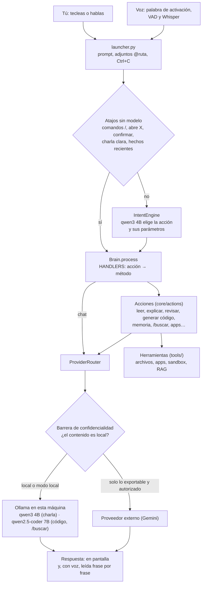

# Arquitectura de Asia

Asia es un asistente de terminal que corre en la laptop con modelos locales de Ollama. Esta página cuenta, sin entrar en el código, por dónde pasa un mensaje, cómo funciona la voz, cómo busca en la biblioteca y dónde guarda cada cosa.

## El camino de un mensaje

1. **launcher.py** recibe lo que escribes (o lo que dijiste, ya pasado a texto), resuelve `@ruta` y los adjuntos, y muestra la respuesta a medida que llega. Ctrl+C corta la respuesta o la lectura sin cerrar Asia.
2. **Atajos.** Muchas órdenes no necesitan un modelo: los comandos con `/`, "abre X", "confirmar cambio", el saludo y la charla clara, las preguntas por la sesión anterior o un hecho posterior a lo que sabe el modelo (ofrece buscarlo en Wikipedia). Ahorran los segundos del IntentEngine.
3. **IntentEngine.** Si ningún atajo aplica, un modelo pequeño (qwen3 4B) decide qué acción es ("explicar archivo", "buscar en la documentación", "chat"…) y extrae sus parámetros. Las rutas que se inventa se descartan.
4. **Brain** tiene una tabla, `HANDLERS`, de acción a método. Cada familia vive en `core/actions/`: exploración, revisión, código, memoria, sandbox, voz, biblioteca, afecto. Si la acción es "chat", va directo a la conversación.
5. **Las acciones** usan herramientas (`tools/`): leer archivos, abrir apps, proponer un cambio que solo se aplica tras "confirmar cambio", correr código en un sandbox, buscar en la biblioteca.
6. **ProviderRouter** arma el prompt y elige el modelo según el dominio: código y búsquedas con qwen2.5-coder 7B, charla con qwen3 4B, matemáticas con razonamiento.
7. **La barrera de confidencialidad.** Cada trozo del prompt lleva su procedencia: lo que tecleaste, la memoria, un archivo, un adjunto, la biblioteca, un proyecto. Hacia un proveedor externo solo sale lo exportable. Lo local se queda, salvo una autorización de una sola vez, y lo "emocional" no sale nunca. Hay un filtro de secretos, y una bitácora de envíos que no guarda el texto. En modo local no sale nada.

## Voz

- **Escuchar.** Con `/voz`, un Enter en una línea vacía abre el micrófono. Silero VAD decide, tramo a tramo, cuándo empieza y termina la frase. Whisper `small`, en la CPU, la pasa a texto con el vocabulario de Asia como pista ("bloc de notas", "ROADMAP"…). Si no hubo voz, o si Whisper "oye" sus frases típicas del silencio, responde "no te oí".
- **Palabra de activación.** Con `/escucha`, openWakeWord escucha en segundo plano. Al oír la palabra suelta el micrófono para Whisper. Por ahora usa "Hey Jarvis" y está en pruebas "Oye Asia", entrenada en Colab.
- **Hablar.** Piper lee la respuesta frase por frase mientras se escribe: la primera frase suena en unos segundos. No lee código, tablas ni rutas. Enter o Ctrl+C cortan la lectura. Con voz, las respuestas son cortas, y "a fondo" pide la versión larga.

## Biblioteca (RAG)

- **Fuentes.** Proyectos propios, documentación técnica y archivos `.zim` sin conexión (Wikipedia y sitios de Stack Exchange), dadas de alta con `/indexar` y listadas con `/fuentes`. Se excluyen secretos, binarios, archivos grandes y lo que diga el `.gitignore`.
- **Buscar.** `/buscar` combina embeddings (`nomic-embed-text` en ChromaDB) y palabras; en los `.zim` busca el artículo o el hilo.
- **Citas verificadas.** El modelo primero copia las líneas que responden, o dice NINGUNA. El código comprueba que esas líneas existen en la fuente y solo entonces se redacta la respuesta, con las líneas verificadas debajo. Si nada se verifica, dice "no lo encontré" en vez de inventar.

## Dónde vive cada dato

| Qué | Dónde | ¿En git? |
|---|---|---|
| Configuración por defecto | `config/defaults.json` | sí |
| Tus ajustes (proveedor, voz, proyecto activo) | `config/settings.json` | no |
| Apps conocidas / aprendidas del menú Inicio | `config/apps.json` / `config/apps_learned.json` | sí / no |
| Memoria personal y resúmenes de proyectos | `memory/memory.json`, `memory/projects/` | no |
| Cambio y ejecución pendientes de confirmar | `memory/pending_change.json`, `memory/pending_run.json` | no |
| Índice de la biblioteca y sus fuentes | `data/chroma/`, `data/biblioteca/` | no |
| Wikipedia y Stack Exchange sin conexión, caché | `data/zim/`, `data/wikipedia/` | no |
| Modelos de voz (Whisper, openWakeWord) y voces de Piper | `data/models/`, `data/voices/` | no |
| Resumen de la última sesión y pendientes | `data/reflexion/` | no |
| Grabaciones para entrenar la palabra | `data/wake/` | no |
| Bitácora de envíos externos (sin el texto) | `logs/external_audit.jsonl` | no |

Todo lo personal se queda en la máquina; lo que está en git es código, configuración por defecto y pruebas. Las pruebas (`pytest`) usan carpetas temporales, y las mediciones con modelos reales están en `test/manual/check_*.py`.
